# 疾风对决网页版 UI 制作图文教程

从开始界面到像素装备的制作过程

这篇教程按实际制作内容，介绍疾风对决网页版的界面是怎样完成的。每一部分都配有素材与效果图：用到 Meowa 的地方，写明功能、参数、提示词和参考图；界面布局与交互则用简短需求描述，方便借助 AI 实现。

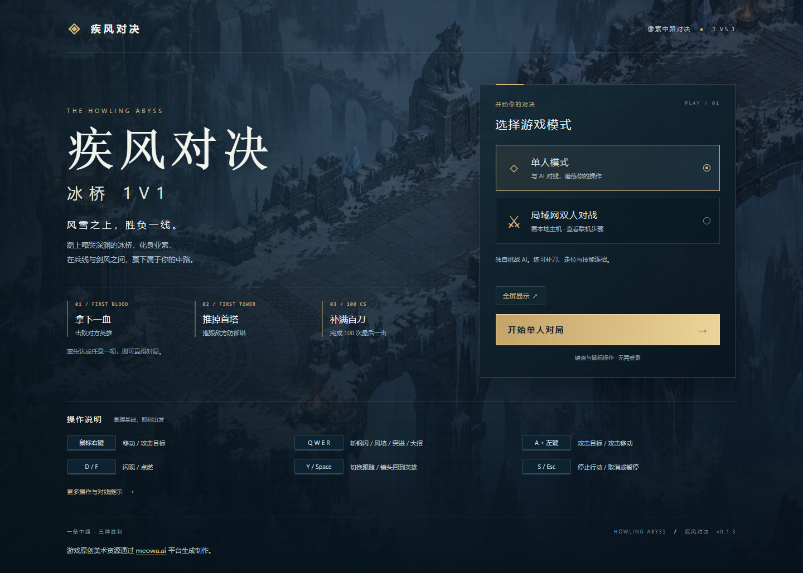

当前游戏的开始界面

可以依次完成开始界面、技能图标、战斗信息栏、操作指引、设置窗口和装备商店。装备图标的白底修正也保留在教程中，便于看清从初稿到最终效果的变化。

示例基于疾风对决网页版 0.1.3。重复生成的细节可能不同；想保留相同画面，也可以直接使用资料包中的成品素材。

## 开始界面背景生成

开始界面使用冰桥场景作为背景，先确定冷蓝灰的环境色，再加入游戏标题与按钮。背景图只负责营造氛围，文字和按钮另行制作。

**Meowa 平台：**通用生成。模型：Image2.5；画质：精细；分辨率：2K；比例：16:9。

**制作步骤：**选择通用生成，输入下方英文原词。画面重点是俯视冰桥、冷色石材与少量暖色火光。

**提示词：**HA01. A beautiful pure gameplay environment target for a pixel art action RPG, inspired by the detailed pixel craftsmanship and stone architecture of Eldest Souls and the atmospheric environmental richness of Hunt the Night. The subject is the Howling Abyss: an ancient Freljord stone bridge suspended above a freezing blue abyss. One coherent wide scene from a fixed steep overhead orthographic gameplay camera. The route flows from a blue team sanctuary platform on the lower left, through an outer defensive tower and its broad circular stone apron, to an open central bridge crossing toward the upper right. The bridge has substantial broken parapets, carved Nordic stone guardians, icy supporting arches and distant cliffs below. Large individually weathered slate flagstones, smaller dark repair cobbles, worn geometric Freljord carvings, frost lodged in joints, wind-shaped snowbanks along the edges, translucent ice over exposed stone and scattered broken masonry form naturally interlocking ground materials. Keep the middle walking route broad and quiet with readable stone surfaces. Cold desaturated blue grey architecture, pale snow, restrained cyan ice crystals and a few small warm braziers. Deliberate crisp pixel clusters and rich material detail at a consistent pixel scale, finished game environment art rather than a 3D render or a painterly illustration. No characters, interface, lettering, labels, arrows, borders or presentation panels.

**参考图：**无，使用文字生成。

### 结果

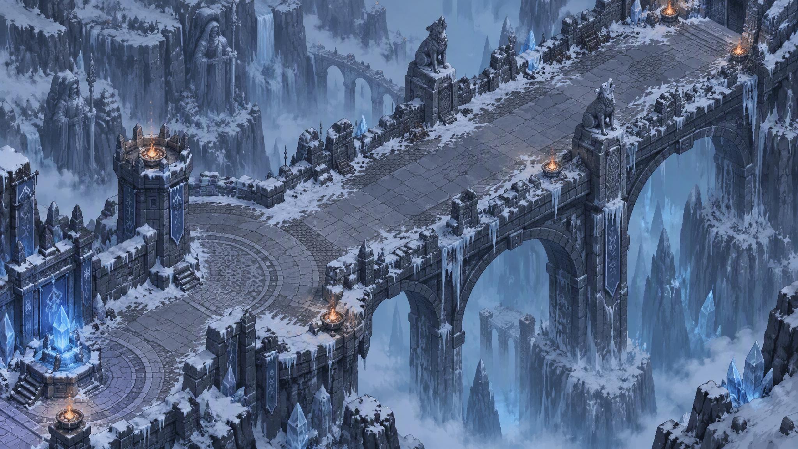

生成的冰桥背景，2048×1152

## 开始界面组合

有了背景图，就可以让 AI 帮助完成菜单布局。画面上保留足够的暗部，让文字和按钮从背景中分离出来。

**制作方式：**这一部分是界面布局与交互，没有额外的 Meowa 生图步骤。

**可交给 AI 的需求描述：**为疾风对决制作像素风开始界面。使用冰桥背景，叠加深色遮罩。左侧放游戏标题与简短说明，右侧放单人练习和对战选项；显示首杀、首塔、补刀100三个胜利条件。保留全屏入口，模式切换在当前页面中完成。

**输入素材：**上一步生成的冰桥背景。

### 结果

背景、标题、胜利条件和模式按钮组合后的效果

查看效果时，重点看标题是否清楚、模式按钮是否容易找到，以及背景有没有抢走文字的注意力。

## 技能与头像图标生成

底部战斗栏先统一图标风格。头像、被动、四个技能和两个召唤师技能放在同一张图中生成，更容易保持边框和配色一致。

**Meowa 平台：**界面生成。分辨率：1K；比例：16:9；画质：普通；去背景：标准；组件分离：开启。历史模型未留存，重新制作可尝试 Image2.5。

**制作步骤：**上传下方两张参考图，分别说明底部战斗栏的布局和 R 技能就绪时的外观，再输入提示词。

**提示词：**Create a crisp pixel-art MOBA HUD icon sheet inspired by the reference interface. Exactly eight separate square icons in two rows of four, read left to right. Top row: portrait of Yasuo, the dark-haired wind swordsman with high ponytail and blue scarf; passive skill, a cyan wind shield with a small sword; Q, silver katana thrust with pale blue wind; W, upright cyan wind barrier. Bottom row: E, a blue swordsman silhouette dashing forward; R READY, bright silver diagonal sword in a violet airborne vortex, fully colored and illuminated; D, golden flash; F, a red-orange flame. All eight icons have consistent thin stepped antique-gold pixel borders and opaque dark navy interiors. Authentic carefully clustered 48-pixel-game artwork with visible square pixels, limited colors, strong silhouettes and hard edges, no smooth painted shading. Equal square icons, generous fully transparent gaps, transparent sheet background. Only these eight icons. No letters, numbers, level badges, equipment, gold counters, buff strips, upgrade arrows or interface panel. Use reference only for icon meaning and palette; redraw all eight in matching pixel art.

### 参考图

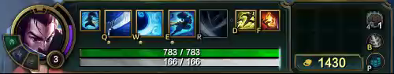

参考图一：底部战斗栏的图标位置与配色

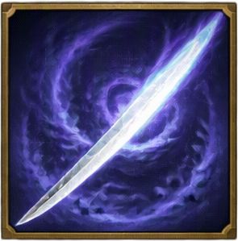

参考图二：R 技能就绪图标

## 图标分离与战斗信息栏

### 第一步 查看生成结果

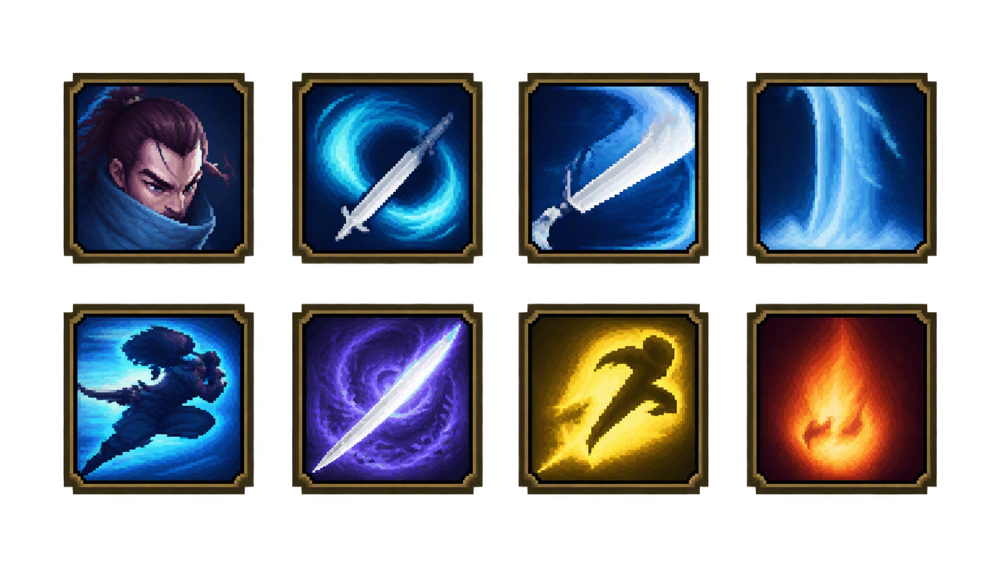

八图标总图，1536×864；上排头像、被动、Q、W，下排 E、R、D、F

将总图中的图标分离为独立图片。生成时只保留图标本身，快捷键、等级、数值与升级按钮由游戏界面叠加，避免文字被画进素材。

### 第二步 组合底部战斗栏

**可交给 AI 的需求描述：**参考原有底部布局，放入生成的头像和技能图标。左侧常驻六项属性，中间显示等级、生命值、剑意与技能；技能下方保留等级格和升级入口，右侧放装备槽。请让文字保持清晰，避免升级提示遮挡血条。

### 结果

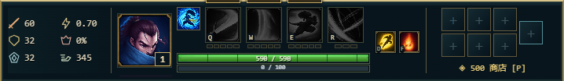

当前底部战斗信息栏，R 和被动使用后续单独重绘的版本

图标缩小到游戏中的尺寸后，仍需能辨认轮廓。放大展示时使用最近邻缩放，避免把清晰像素变成模糊边缘。

## R 技能与被动图标补绘

总图完成后，R 技能和被动又分别参考原版图标重绘，用来调整细节与辨识度。

**Meowa 平台：**通用生成。画质：精细；分辨率：1K；比例：1:1；去背景：关闭；每次上传一张参考图。历史模型未留存，复刻可尝试 Image2.5。

这两张图的历史原始提示词没有留存。下方文字为复刻建议，可用于重新制作。

### 第一步 R 技能图标

**提示词 复刻建议：**参考输入图，重绘亚索狂风绝息斩技能图标。保留深蓝背景、交错的青蓝刀光和横贯下半部的弧形亮刃，使用清晰方形像素簇，与现有冰桥 HUD 配色一致。单个正方形图标，不添加文字、数字或外部界面。

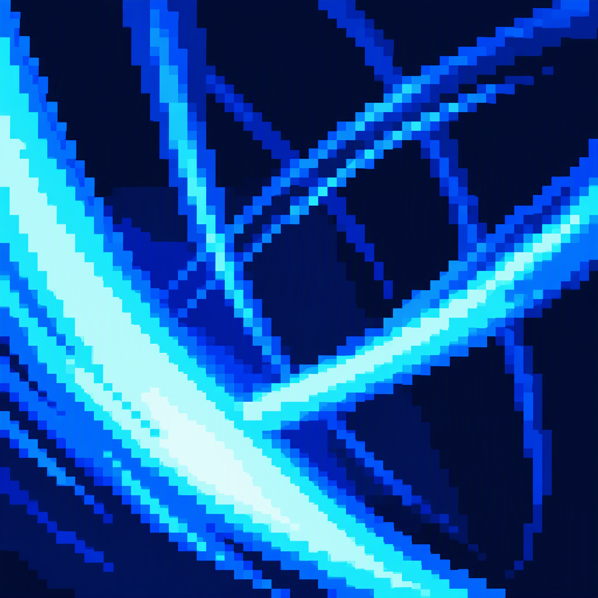

### 第二步 被动图标

**提示词 复刻建议：**参考输入图，重绘亚索浪客之道被动图标。保留环绕的青蓝气流、中央深色剑客剪影和少量金色细节，使用清晰像素轮廓和深色不透明背景，与现有冰桥 HUD 一致。不添加文字、数字或其他图标。

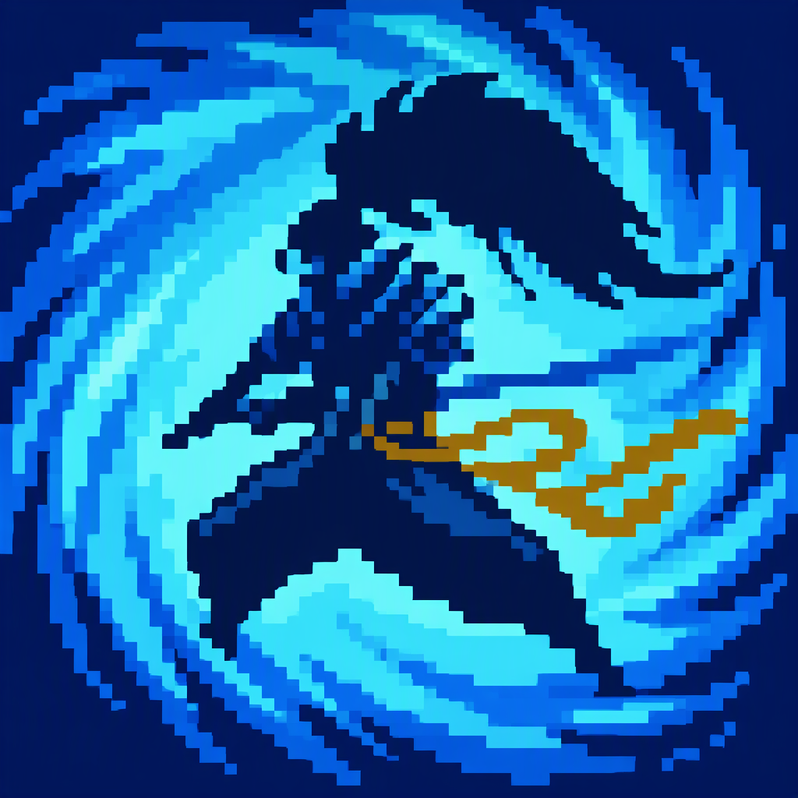

两张结果均为1024×1024不透明PNG，替换底部栏中对应的图标即可。

## 新手操作指引

指引采用随时可查的小面板。玩家可以在需要时展开，不必跟随引导人物完成一串任务。

**制作方式：**由 AI 协助制作界面与交互，本步骤不需要 Meowa 生图。

**可交给 AI 的需求描述：**在游戏左上角制作可折叠的操作指南。将内容分为鼠标与镜头、战斗与装备两部分，说明移动、普攻、A键选目标、技能施放、取消选点和打开商店。技能悬停时显示说明；指引展开时不要遮住主要战斗区域。

### 结果

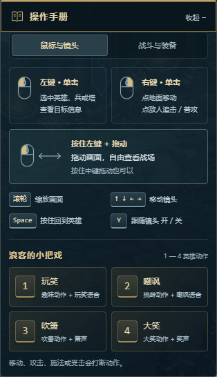

展开后的操作指引面板

按当前游戏的实际按键和施法方式填写内容。说明尽量短，让玩家可以一边查看，一边继续游戏。

## 设置窗口

设置集中放在屏幕中间，让操作选项和视频选项有清楚的入口。打开设置使用 F10，避免与退出全屏的 Esc 冲突。

**制作方式：**由 AI 协助制作界面与交互，本步骤不需要 Meowa 生图。

**可交给 AI 的需求描述：**制作居中的设置窗口，用 F10 打开或关闭。窗口包含操作和视频两个页签。操作页整理技能施法方式；视频页整理画面相关选项。使用与底部战斗栏一致的深色面板、金色细边和清楚的选中状态。

### 结果

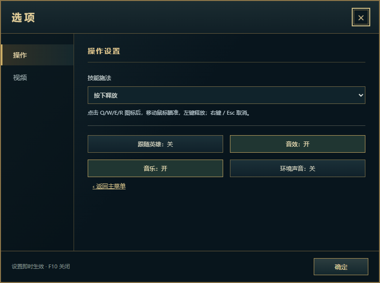

当前居中设置窗口

实际检查时，可依次切换页签、调整选项、关闭再打开，确认状态与游戏中的表现一致。

## 装备图标像素化

装备以每一件原版图标为参考逐张转换。这样既能保留原有的形状与朝向，也能把装备统一成游戏使用的像素美术。

**Meowa 平台：**精确像素生成。尺寸：64×64；模型：Nano Banana；人像模式；去背景：关闭；填满画布：关闭；强力像素化：开启。

**提示词：**保持原有的朝向和美术风格，变为像素化

### 第一步 上传原版图标

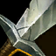

一次以一件装备图标作为参考，使用同一套尺寸与参数生成。虽然这里制作的是装备，历史配置中使用的内容模式确实为“人像模式”。

### 第二步 查看像素化结果

最终得到229张64×64装备图标。3024这一件在生成失败后改用Image2，其余参数记录保留在配套文件中。首轮结果有明显白底，下一步继续处理背景。

## 装备图标背景修正

白底图标放进深色商店后很显眼。对照原版，可以看到装备通常处于深色氛围中，亮部主要集中在武器、药瓶和魔法光效上。

### 第一步 去掉白色背景

**Meowa 平台：**去背景。模式：像素；画质：普通；每批最多16张；保留半透明：关闭。输入是首轮像素图标，批量处理时使用无损WebP。

**提示词：**此步骤无需提示词，直接处理输入图片。

### 第二步 恢复原版的深色氛围

去背景后保留装备前景，再合成接近原版的深色背景。这一步由 AI 协助做图片处理，不是再次在 Meowa 中输入文字生成。

**可交给 AI 的处理需求：**去掉白底，保留装备自身的颜色、轮廓和高光。参考同一件原版图标的深色调，将背景调暗，避免白边；不要重绘装备主体，输出仍保持64×64。

### 参考图与结果

每组三列：原版、白底像素初稿、深色背景修正版。图中“当前像素版”指修正前初稿。

最终保留229张深色图标，其中227张修正白底，2055和3072沿用原有背景。背景在视觉上接近原版的深色调，并非逐像素复原。

## 场景商人摊位生成

除了商店面板，场景中的商店入口也制作了独立素材。酒红色棚布与暖色灯笼帮助玩家识别入口，冷色阴影则呼应冰桥环境。

**Meowa 平台：**通用生成。模型：Image2.5；画质：极致；分辨率：1K；比例：1:1；去背景：标准。

**提示词：**One small fantasy weapon merchant stall as a transparent game prop, isometric three-quarter view seen from above, matching a hand-painted pixel-style snowy ancient stone bridge MOBA. A low wooden counter under a short faded burgundy cloth awning dusted with snow. Two warm amber hanging lanterns, a hanging wooden shield-shaped sign with a golden sword symbol and no writing, a rack of steel swords, a few glowing cyan and red potion bottles, a wooden chest and two little supply crates at the sides. Compact silhouette, low enough to sit beside a tall existing sanctuary building without obscuring it. Front of stall faces toward bottom of image. No people, no background, no floor tile, no text. Center complete prop with transparent padding around all sides, crisp detailed materials, cold blue shadows and warm shop lighting.

**参考图：**无，使用文字生成。

### 结果

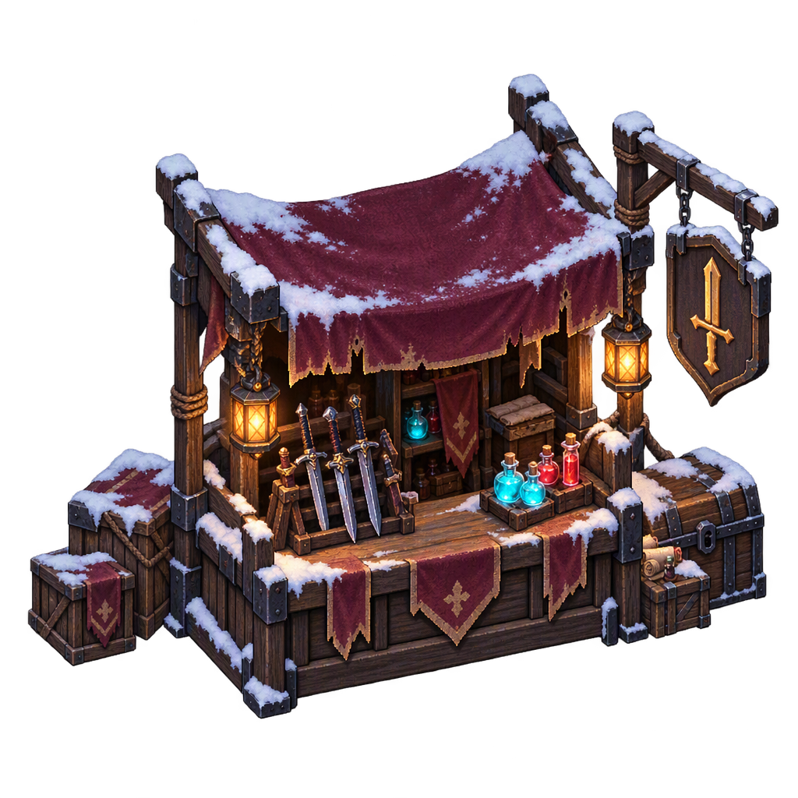

生成的商人摊位，1024×1024透明PNG

将素材放到场景商店入口附近，再让 AI 关联打开商店的交互。调整大小时，避免摊位遮住已有建筑和玩家行走区域。

## 装备商店与最终效果

最后将深色像素图标放回游戏。商店列表、合成信息和底部装备栏使用同一套装备图片，玩家查看和购买时就能保持一致的识别体验。

**制作方式：**商店界面由 AI 协助实现，装备图片使用前面生成并修正的结果。

**可交给 AI 的需求描述：**制作深色装备商店，使用对应装备的像素图标，展示名称、价格、属性和合成信息。底部保留六个装备槽和独立饰品位置；P键打开商店。确保商店与装备栏显示同一件装备时使用相同图片。

### 结果

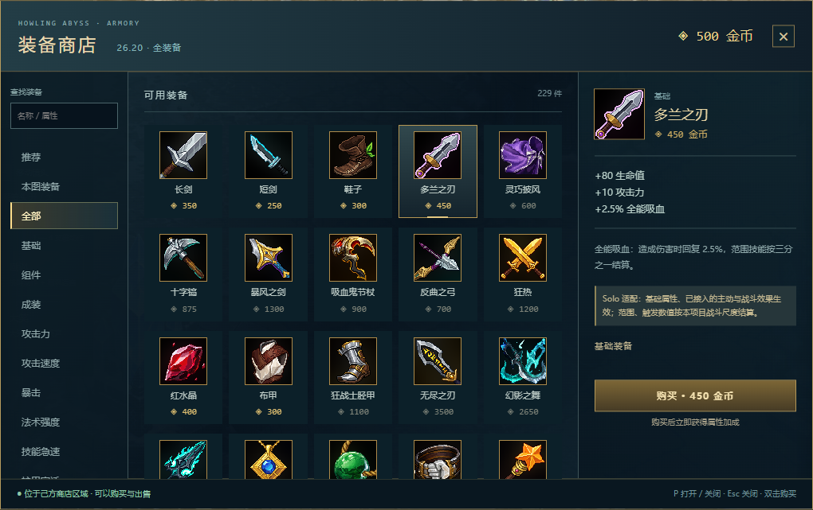

替换深色像素装备图标后的商店

进入游戏后检查三件事：图标缩小时是否看得清，背景是否融入深色面板，同一件装备在商店与装备栏中是否一致。再检查技能升级、指南和设置入口，就完成了这套 UI 的主要制作流程。

资料包中的 images 为结果图，inputs 为参考图，Meowa资源复刻配方.json 保存完整生成记录。按照各章节的参考图、参数和结果图，可以重做资源，也可以对照成品继续调整。
