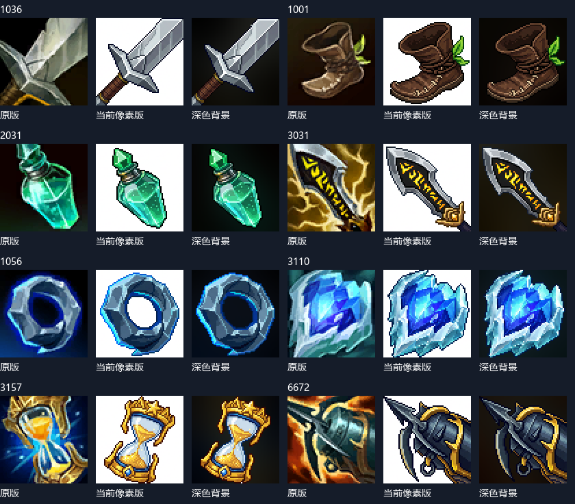

# 疾风对决网页版 UI 制作与复刻手册

版本基准 v0.1.3 · 2026-10-23 · Asia/Shanghai


## 阅读范围与复刻目标

本手册整理六段指定对话中的 UI 制作过程，并以 2026 年 10 月 23 日的疾风对决网页版 v0.1.3 源码与实机为最终验收基准。目标是在现有游戏与 Match 数据模型上复刻同样的菜单、HUD、操作指南、设置、属性、技能和装备界面，不扩展为角色动画或整张地图的制作教程。

当前项目根目录为 D:/Long1ye/疾风对决网页版。早期制作档案保存在同级 pixel-league-of-legends-V2，部分最早参考来自 pixel-league-of-legends。不要把旧工程的界面状态当作当前版本。


图 1 当前网页版商店。图标为 64×64 深色背景像素版，文字与按钮为 DOM 和 CSS。

精确复现画面时，优先使用工程已有成品。Meowa 重新生成可能改变局部构图与像素细节，相同提示词和参数不保证逐像素相同。文中将“历史原始提示词”“复刻建议”和“本地后处理”明确区分。

配套文件：Meowa资源复刻配方.json 保存可复制配方；inputs 保存两张 HUD 裁切参考和 R／被动官方参考；tools 保存裁切与背景处理辅助脚本；code 保存关键 UI 代码快照，依赖本游戏其余模块，不是独立游戏包；Markdown 版保留全部代码块与资源路径。


## 从稳定界面到当前网页版

| 阶段 | 实际迭代 | 当前应复刻的结果 |
| --- | --- | --- |
| 10 月 15 日资源基础 | 制作像素 HUD 图标，提取客户端血条与光标 | QWE、头像、D/F 沿用八图标产物；R 和被动后来单独重绘 |
| 10 月 19 日稳定 UI | 恢复底部栏、头顶与塔血条、顶部战绩；随后移除小地图 | 保留稳定的框架和实时反馈，不添加旧版小地图 |
| 10 月 19 日操作指南 | 用户否定任务式教学，改成可折叠速查面板；补上 A 键和技能提示 | 常驻可查，无引导人物、无任务推进门槛 |
| 10 月 19 日开始界面 | 加入名称、三种胜利条件、单人／对战选项、全屏和缓存 | 当前标题为疾风对决；页面内切换维持全屏 |
| 10 月 20 日属性技能 | 六项属性常驻；加点按钮与等级格；设置改居中窗口 | F10 开关设置，Esc 留给退出全屏和取消选点 |
| 10 月 20 日装备 | 16 件生成图标 → 完善图标 → 扩展为 229 件原版图标 | 商店、合成树、六格装备、独立饰品共用 ID 映射 |
| 10 月 22 至 23 日补充 | 本聊天生成 229 张像素装备，并去除白底、恢复深色背景 | 当前加载 equipment-pixel-dark-64，不再加载原版或白底版 |

不要恢复早期“属性藏在菜单里”“D/F 不可用”“没有等级和装备”“右下小地图”这些历史状态。它们出现在旧资源 README 中，但已被后续对话和当前代码替代。16 张装备图集的生成过程应保留在历史章节，不应用到当前 229 件目录。


## 工程准备与界面分层

```text
cd D:/Long1ye/疾风对决网页版
npm ci
npm run build
npm start
# 打开终端打印的网址，默认端口 5180
# 本手册截图来自运行中的平台预览端口 5197
```

环境使用 Node.js 24 或兼容的新版本，实际依赖以 package-lock.json 为准。项目为 Vite、TypeScript、Three.js 与 Phaser；正常网页菜单默认进入 Three.js 冰桥对局，原渲染入口保留。普通模式装备数据固定为 DDragon 16.20.1，不在运行时追随外网更新。

资源命令使用 PowerShell。先在工程根安装 game-assets 并配置本地认证，再在另一终端设置下面变量。随后所有 inputs／images／tools 路径相对手册目录；assets／src 输出路径的含义则相对游戏工程根。CLI 选择项与原记录已核对。

```text
$Game = 'D:/Long1ye/疾风对决网页版'
$Guide = "$Game/docs/UI制作复刻手册"
$Cli = "$Game/.agents/skills/game-assets/meowart_api.py"
Set-Location $Guide
# pip install Pillow   # 仅本地裁切与背景辅助工具需要
```

| 层 | 主要文件 | 职责 |
| --- | --- | --- |
| 页面与生命周期 | src/launch.ts、index.html、three.html | 保留根文档，挂载菜单／房间／对局，销毁旧监听和渲染器 |
| HUD 组成 | src/ui/LeagueHud.ts、ThreeHud.ts | 挂载头像、技能、状态、属性、装备、目标信息 |
| 实时数据 | ChampionHud.ts、EquipmentHud.ts、game/Match.ts | 读取真实属性、等级、冷却、金币和库存，操作提交给模拟层 |
| 交互状态 | presentation/SkillCasting.ts、ui/CastSettings.ts | 处理按下释放、按住预览、图标选技能和取消 |
| 绘制与位置 | render-three/WorldHealthBars.ts、TargetCooldownRings.ts | 屏幕空间血条、世界坐标投影、E 对目标冷却圈 |
| 素材与样式 | assets/ui、src/ui/*.css | 像素图作为贴图；文字、键帽、边框、布局与遮罩由代码绘制 |

先建立稳定 DOM 容器和数据更新接口，再加美术。不要让 Meowa 生成整张带数字的 HUD 后当静态图片覆盖：血量、等级、冷却、金币必须能单独更新。


## 恢复稳定 HUD 与血条


图 2 当前底部 HUD，包括常驻属性、头像等级、技能、资源、D/F 和装备栏。

按 LeagueHud.ts 的顺序，在模板存在后执行挂载：加载图标 → mountChampionHud → mountEquipmentHud → mountPlayerSettings。游戏每帧读取真实 Match／hero 状态刷新；不要反复重建整个面板。保持 ability-q 等原有 ID 和事件，移动控件时保留原节点。

| 元素 | 桌面基准 | 实现要点 |
| --- | --- | --- |
| 色彩 | 底色 #08151c；框色 #9d874e；高光 #dbc48a | 硬边细框、少量阶梯切角，避免大面积圆角 |
| HUD 布局 | 有装备时 CSS 宽 718px；列为 132／68／244／56／158px | 属性、头像、技能资源、召唤师技能、装备分列 |
| 技能与头像 | 技能槽 44×44；被动 28×28；头像 68×68 | image-rendering: pixelated；图标不含实时文字 |
| 世界血条 | 英雄每 100 生命一格；塔每 250 生命一格 | 我方绿、敌方红；塔不增加无用途资源黑条 |
| 掉血残影 | 停留 0.18 秒，再以每秒 1.5 比例追赶 | HealthBarTrail 使用模拟时间，暂停冻结，治疗立即更新 |

血条防抖使用 WorldHealthBars 的屏幕空间 Canvas 层：位置与角色共用插值坐标，再用相机投影；不跟着世界帧缓冲一起缩放，不对每帧坐标强行取整。场景切换清理旧状态。旧 HeroHealthBar 类存在不代表当前主入口采用世界网格血条。

原版血条、光标来自本机客户端的只读提取，不是 Meowa 生成。assets/ui/riot-healthbars-2026-10-15/runtime 保存裁切成品。精确复刻可直接引用这些文件；当前无需重新解析 WAD。


## 开始菜单与全屏切换


图 3 当前开始菜单。背景为已有 Meowa 总览概念图，所有文案和按钮为 HTML。

在 StartScreen.ts 创建 .start-screen；左侧展示名称和三项胜利条件，右侧为模式卡片与开始按钮，下方放操作说明。start-screen.css 的主栅格使用 minmax(0,1.45fr) 与 minmax(330px,1fr)，桌面列间距 72px；不足宽度时切换单列。保留深色遮罩，背景图未就绪时仍能看清文字。

菜单创建完成后异步加载 01-overview.png，写入 --start-art。点击开始后禁用按钮，显示“正在进入”，等对局界面就绪才移除菜单。launcher-pending 期间隐藏旧调试内容，避免白底页面闪现。平台域名上的联机按钮展示指引，本地主机才进入房间大厅。

全屏对象使用 document.documentElement。模式切换、返回菜单、再次开局使用 history.replaceState 与组件销毁重建，不用 location.reload 或跳转另一个文档。Fullscreen.ts 的清理函数只移除监听，不主动退出全屏；只有玩家点退出或浏览器 Esc 才退出。


## 操作指南与施法提示

操作指南最终采用速查面板，而不是引导人物或步骤任务。OperationGuide.ts 使用 details／summary；当前桌面位置 left:14px、top:82px、宽 314px。内容分“鼠标与镜头”“战斗与装备”两个页签，键帽和鼠标示意是 SVG 与 CSS，不消耗生成额度。默认展开与收起偏好按代码保存在本机。

必须覆盖右键移动／攻击、左键选择、拖动镜头、滚轮、Space、Y、A → 左键、QWER、Ctrl 加点、D/F、P、F10 和英雄动作。当前 1/2/4 给表情，装备前两格使用 Alt+1／Alt+2，饰品为 Alt+4，其余为 5/6/7/8；不要照抄最初装备版本的数字键映射。

```text
// SkillCasting 的核心状态，不直接在预览时扣资源
mode: 'instant' | 'release'
active: AbilityKey | null
source: 'keyboard' | 'ui' | null
keyDown: instant → cast；release → select
keyUp: 仅确认由该键盘技能启动的预览
点击图标: select(key, 'ui')；左键: confirm()
右键或 Esc: cancel()；切换模式先 cancel()
```

CastSettings.ts 的选择器写入 midline-cast-mode。技能悬停提示由文本说明加实时等级／伤害／冷却组成；R 提示需要击飞目标。确认后才向模拟层提交 cast，联机只发送指令，不发送前端算出的伤害或价格。

范围反馈统一青蓝半透明线条。A 圈中心取英雄脚下投影，不取鼠标点；E 冷却圈跟随被 E 命中的单位，用 targetLocks 的剩余时间绘制白色弧线，冷却结束删除。W 落点在这次历史迭代中由 32 前移至 48，预览与实际效果必须共用同一位置计算。


## 常驻属性 加点与设置窗口

ChampionHud.ts 直接在底部技能栏左侧加入六项属性：攻击力、护甲、魔抗、攻速、暴击率、移速。图形用 SVG 路径绘制，数字每帧从 hero 更新；攻速用 1 / attackInterval，暴击率走 yasuoCritStats，移速按项目 worldScale 还原显示。不要把法力当成亚索的可消耗资源，资源条应显示剑意。

头像叠加等级，经验条读取 experienceProgress。Q/W/E/R 分别生成升级按钮和 5/5/5/3 个等级格，按钮是否出现由 canUpgradeSkill 决定；未学习技能显示变暗状态。技能格独占一行，避免遮挡血条。按钮点击 stopPropagation 后提交升级，再把焦点还给游戏。


图 4 居中设置窗口，操作与视频为两个页签。

设置使用原生 dialog.showModal；当前最大 780×580px，边框 #8c7549，深色背景。F10 在捕获阶段开关，非重复按键才切换。窗口打开时拦截游戏快捷键，Esc 的 cancel 默认行为被阻止，以免和退出全屏冲突。操作页放施法、镜头与声音；视频页放画面精度、环境质量、增强和全屏。调试场景不展示给玩家。


## 装备商店与统一图标加载

EquipmentHud.ts 在 HUD 后追加六格装备与独立饰品位，并创建 .equipment-shop。桌面商店最大 1020×640px，主体为 160px 分类栏、弹性列表、294px 详情栏。详情包含属性、原版说明、Solo 适配说明、配方、升级方向和买卖按钮。

```text
const icons = import.meta.glob(
  '../../assets/ui/equipment-pixel-dark-64/*.png',
  {eager:true, query:'?url', import:'default'}
) as Record<string,string>;
const urls = new Map(Object.entries(icons).map(([p,u]) =>
  [Number(p.match(/\/(\d+)\.png$/)![1]), u]));
// 每个 ITEMS 条目必须有地址，否则启动失败，禁止悄悄用错图兜底
```

图标使用 ID，不使用图集序号：1036.png 永远对应长剑。EquipmentIcons.ts 被商店、装备栏、目标面板和状态图标共用。运行前 decode 全部图片，避免首次打开商店才闪图。列表图标 CSS 常规 48×48，桌面商品卡 58×58；保持方形，不拉伸成横条。

P、金币按钮、己方圣所／商店招牌可打开商店；浏览不限制位置，实际交易由模拟层检查金币、泉水距离、栏位、条件和配方。搜索框输入优先，不应触发技能。购买仅提交装备 ID，组件抵扣与满栏合成在服务端处理；新局重置经济与装备。

当前目录 229 件，数据来自项目固定的 16.20.1 文件；不能把“229”写死在界面计数里。用 ITEMS.length、实际过滤结果与状态生成数量。本文不新增或修改装备数值。


## Meowa 八图标 HUD 配方

这是当前头像、Q/W/E 与 D/F 的基础来源。功能是界面生成 ui-gen-run，生成模式；输入为附带的 inputs/hud-layout.png 与 inputs/hud-r-ready.png。前者是原版实机 HUD 裁切，后者提供 R 就绪的彩色状态，不能把冷却灰图当作美术颜色。

| 参数 | 已核验的历史值 |
| --- | --- |
| 分辨率与比例 | 1K，16:9；实际总图 1536×864 |
| 质量与处理 | 普通 standard；标准去背景；自动组件分割开启 |
| 模型 | 原记录未返回模型名；复刻新任务建议明确选 Image2.5 |
| 输出 | 一张 ui_output.png；后续按人工验证矩形裁出八图标 |

以下为 plan.json 中保存的原始提示词。它描述 48 像素级质感，不代表输出文件只有 48×48。

```text
Create a crisp pixel-art MOBA HUD icon sheet inspired by the reference interface. Exactly eight separate square icons in two rows of four, read left to right. Top row: portrait of Yasuo, the dark-haired wind swordsman with high ponytail and blue scarf; passive skill, a cyan wind shield with a small sword; Q, silver katana thrust with pale blue wind; W, upright cyan wind barrier. Bottom row: E, a blue swordsman silhouette dashing forward; R READY, bright silver diagonal sword in a violet airborne vortex, fully colored and illuminated; D, golden flash; F, a red-orange flame. All eight icons have consistent thin stepped antique-gold pixel borders and opaque dark navy interiors. Authentic carefully clustered 48-pixel-game artwork with visible square pixels, limited colors, strong silhouettes and hard edges, no smooth painted shading. Equal square icons, generous fully transparent gaps, transparent sheet background. Only these eight icons. No letters, numbers, level badges, equipment, gold counters, buff strips, upgrade arrows or interface panel. Use reference only for icon meaning and palette; redraw all eight in matching pixel art.
```

```text
python "$Cli" ui-gen-run    --mode generate --generation-model image-2.5 --quality standard    --resolution 1K --aspect-ratio 16:9 --remove-bg-method standard    --reference-image inputs/hud-layout.png    --reference-image inputs/hud-r-ready.png    --prompt "<从 JSON 复制 hud-eight 的 prompt>"    --output-dir outputs/hud-eight
```

原任务 job_8985ee41f61e478fafb6aa4ccbfbc30a。重新生成后先检查顺序、透明间隙和 R 颜色，再决定裁切；下页坐标仅适用于附带的原总图。


## 八图标裁切与技能图标修正

| 名称 | 左 上 右 下 | 裁切尺寸 |
| --- | --- | --- |
| portrait | 106 121 382 398 | 276×277 |
| passive | 457 121 735 398 | 278×277 |
| q | 807 121 1085 398 | 278×277 |
| w | 1156 121 1432 398 | 276×277 |
| e | 107 477 382 753 | 275×276 |
| r | 458 477 734 753 | 276×276 |
| d | 807 477 1084 753 | 277×276 |
| f | 1157 477 1432 753 | 275×276 |

```text
python tools/crop-hud.py --atlas images/eight-icons-sheet.png    --rects tools/hud-crops.json --output ./hud-runtime
```

crop-hud.py 只裁切，不缩放、不再次像素化。原 Q/W/E 运行时仍约 275～278 像素宽，HUD 通过最近邻显示到约 44px。这是原生图标裁切文件尺寸与屏幕显示尺寸的区别。R 与被动后来被两个独立图标覆盖，八图标总图中的旧 R／被动不再是当前最终图。

| 最终图标 | 输入 | 已核验参数与输出 |
| --- | --- | --- |
| R | inputs/official-yasuo-r.png | 通用生成；1K，1:1，精细 detailed，不去背景，1 个参考；1024×1024 RGB PNG |
| 被动 | inputs/official-yasuo-passive.png | 通用生成；1K，1:1，精细 detailed，不去背景，1 个参考；1024×1024 RGB PNG |

两次任务的原始提示词与模型名未在可读取记录中保留。下列是根据参考图和已交付产物写出的复刻建议，不冒充历史原文；建议模型 Image2.5。

R 建议提示词：参考输入图，重绘亚索狂风绝息斩技能图标。保留深蓝背景、交错的青蓝刀光和横贯下半部的弧形亮刃，使用清晰方形像素簇，与现有冰桥 HUD 配色一致。单个正方形图标，不添加文字、数字或外部界面。

被动建议提示词：参考输入图，重绘亚索浪客之道被动图标。保留环绕的青蓝气流、中央深色剑客剪影和少量金色细节，使用清晰像素轮廓和深色不透明背景，与现有冰桥 HUD 一致。不添加文字、数字或其他图标。

最终引用见 LeagueHud.ts；R 与被动来自各自专用 runtime 目录。完整路径、任务 ID 与参数见 JSON 配方。


## Meowa 开始菜单背景配方

StartScreen.ts 使用现有的 Howling Abyss 总览概念图作为装饰背景，不是让 Meowa 生成带按钮的整张菜单。输入为纯文本，无参考图；功能为通用生成 general-image-run，Image2.5、精细 detailed、2K、16:9；结果是 2048×1152 不透明 PNG。

以下为已恢复的 HA01 原始提示词。

```text
HA01. A beautiful pure gameplay environment target for a pixel art action RPG, inspired by the detailed pixel craftsmanship and stone architecture of Eldest Souls and the atmospheric environmental richness of Hunt the Night. The subject is the Howling Abyss: an ancient Freljord stone bridge suspended above a freezing blue abyss. One coherent wide scene from a fixed steep overhead orthographic gameplay camera. The route flows from a blue team sanctuary platform on the lower left, through an outer defensive tower and its broad circular stone apron, to an open central bridge crossing toward the upper right. The bridge has substantial broken parapets, carved Nordic stone guardians, icy supporting arches and distant cliffs below. Large individually weathered slate flagstones, smaller dark repair cobbles, worn geometric Freljord carvings, frost lodged in joints, wind-shaped snowbanks along the edges, translucent ice over exposed stone and scattered broken masonry form naturally interlocking ground materials. Keep the middle walking route broad and quiet with readable stone surfaces. Cold desaturated blue grey architecture, pale snow, restrained cyan ice crystals and a few small warm braziers. Deliberate crisp pixel clusters and rich material detail at a consistent pixel scale, finished game environment art rather than a 3D render or a painterly illustration. No characters, interface, lettering, labels, arrows, borders or presentation panels.
```

输出路径 assets/map-concepts/howling-abyss-target-v1/01-overview.png，任务 job_2e5ea341f7d44a73ae909c70337c1592。图中不含按钮、文字和玩家，使用 CSS 遮罩、背景定位与对比度控制承载实际菜单。其他出生区、外塔和中央桥段概念图不参与开始菜单背景选择，不需要为了复刻菜单全部重做。

```text
python "$Cli" general-image-run    --generation-model image-2.5 --quality detailed    --resolution 2K --aspect-ratio 16:9    --prompt "<从 JSON 复制 menu-overview 的 prompt>"    --output-dir outputs/menu-background
```


## 早期十六件装备图集的制作

这一阶段解释装备 UI 的演进，不是当前图标接入方案。首轮使用通用生成 general-image-run，Image2.5、极致 ultimate、2K、1:1，无参考图；输出 2048×2048 不透明 PNG，4×4 图集，每格 512×512。

第一轮原始提示词：

```text
Create a production game item icon atlas, exactly 4 columns and 4 rows of equally sized square icons, edge to edge with no gutters, no text or numbers. Hand-painted fantasy pixel style, rich jewel colors, dark navy backgrounds and thin antique gold borders, recognizable silhouettes at small HUD size, suitable for an icy MOBA battlefield. Row 1: simple steel longsword, silver dagger, brown leather boots, bronze sword with red ruby. Row 2: purple luminous cloak, heavy steel pickaxe, broad golden greatsword, red vampiric curved scepter. Row 3: turquoise recurve bow, twin silver blades with green energy, large red ruby, folded steel chain armor. Row 4: armored golden berserker boots with orange wings, legendary golden infinity sword radiating amber light, crossed spectral swords with teal mist, black curved ruined king blade glowing emerald. Exactly one item per square, consistent scale, fill each icon with the item and its subtle magical background.
```

首轮有背景过繁、部分道具相似等问题。第二轮使用万能编辑 image-edit-run，以首轮图集为唯一参考，高清 hd 模式、Image2.5、极致、2K、不去背景，保持原来的 4×4 顺序。第二轮原始提示词见下一页。

首轮任务 job_c55efa7e77614a3f800b249dac3d1f58。它的运行时曾用 CSS 背景百分比定位；第二轮改为按 ID 导出的独立 WebP，避免定位与长宽比错误。后来用户明确要求 229 件统一原版图标，两套生成图集均退出运行时。


## 图集完善与圣所商店素材

第二轮原始提示词：

```text
Redesign this complete sixteen-item MOBA equipment atlas for clearer recognition in a tiny inventory. Keep exactly the same 4 by 4 grid, equal square cells, order and opaque square format. Use cohesive hand-painted fantasy pixel-style objects, large clean silhouettes, simple dark backgrounds, restrained magical accents, and thin antique-gold borders. Remove the detailed castle scenery and decorative border corners so the objects dominate. No text or numbers. Row 1: a plain slender steel longsword with brown grip; a short triangular silver dagger; simple brown leather boots; a broad curved bronze Doran sword with a red gem and red grip. Row 2: a folded purple agility cloak; a rugged iron pickaxe with wooden handle; a massive broad SILVER two-handed greatsword with dark steel fittings and icy blue highlights, clearly different from the golden legendary sword; a hooked dark vampiric scepter holding a crimson orb. Row 3: a compact recurved wooden and turquoise bow with a visible bowstring; two curved ivory dueling blades crossing over a restrained MAGENTA aura; a single large vivid ruby; a padded tan CLOTH vest with stitches and fabric folds, no metal plates or chainmail. Row 4: a single heavy golden berserker boot with a red-orange wing motif; an ornate GOLD legendary infinity sword with a small infinity-shaped guard and amber edge; two slim spectral TEAL swords in a ghostly dance; a heavy jagged BLACK ruined king sword with an emerald glowing fissure. Keep gold light reserved for legendary equipment. Each whole object fits inside its cell with consistent small padding. Preserve readable shapes at 32 and 48 pixels.
```

结果为同顺序的 4×4 图集，按装备 ID 导出 16 张原生 512×512 无损 WebP。任务 job_618a17613ee34b1b9df33dcda7108d8b。导出程序位于原工程 scripts/export-equipment-icons.py；此脚本依赖历史 16 件表，不能直接用于当前 229 件 JSON 目录。

圣所入口另用了一个 Meowa 商摊道具。功能为通用生成，Image2.5、极致、1K、1:1、标准去背景，无参考图；输出 1024×1024 RGBA PNG，位置为 assets/map-modules/sanctuary-shop-2026-10-20/runtime/shop.png。下面的完整提示词也保存在 JSON 的 sanctuary-stall 条目。

商摊在 SanctuaryShop.ts 中显示，圣所主体、摊位与招牌共同连接商店开关。透明像素不应阻挡地面拾取，拖动超过阈值不应误开商店。招牌文字由 DOM 叠加，不要求 Meowa 在图上写中文。


## Meowa 圣所商摊原始提示词

```text
One small fantasy weapon merchant stall as a transparent game prop, isometric three-quarter view seen from above, matching a hand-painted pixel-style snowy ancient stone bridge MOBA. A low wooden counter under a short faded burgundy cloth awning dusted with snow. Two warm amber hanging lanterns, a hanging wooden shield-shaped sign with a golden sword symbol and no writing, a rack of steel swords, a few glowing cyan and red potion bottles, a wooden chest and two little supply crates at the sides. Compact silhouette, low enough to sit beside a tall existing sanctuary building without obscuring it. Front of stall faces toward bottom of image. No people, no background, no floor tile, no text. Center complete prop with transparent padding around all sides, crisp detailed materials, cold blue shadows and warm shop lighting.
```

输出结果：覆雪酒红棚顶、暖灯、武器架、药瓶和货箱组成一个透明独立道具，不含 NPC、地板或文字。任务 job_4b180f8a4982479ca4fc311f3033e3f2。原建筑保留，道具只增强商店识别，不改变泉水购买半径或地图碰撞。

```text
python "$Cli" general-image-run    --generation-model image-2.5 --quality ultimate    --resolution 1K --aspect-ratio 1:1 --remove-bg-method standard    --prompt "<从 JSON 复制 sanctuary-stall 的 prompt>"    --output-dir outputs/sanctuary-stall
```

联机时判断玩家实际所属队伍，只允许己方圣所打开商店；右键仍移动，技能确认和 A 攻击选点优先于商店拾取。购买按钮可显示不可购买原因，但不能只靠按钮禁用代替模拟层校验。


## 当前二百二十九件像素装备配方

当前像素版是在用户确认四张样图后扩展到全部 229 件。每件独立输入本地的原版图标 assets/ui/league-items-16.20.1/<id>.png，统一使用精确尺寸像素生成 custom-size-pixel-gen-run。

| 选项 | 实际选择 |
| --- | --- |
| 提示词原文 | 保持原有的朝向和美术风格，变为像素化 |
| 生成尺寸 | 宽 64，高 64 |
| 模型与内容模式 | Nano Banana；人像模式 portrait |
| 背景与构图 | 关闭去背景 none；关闭填满画布 |
| 像素选项 | 开启强力像素化 strong-pixelation |
| 单项例外 | 3024 冰川圆盾连续失败后改用 Image2，其他选项不变 |

```text
python "$Cli" custom-size-pixel-gen-run    --prompt "保持原有的朝向和美术风格，变为像素化"    --width 64 --height 64 --generation-model nano-banana    --content-mode portrait --remove-bg-method none    --no-fill-canvas --strong-pixelation    --reference-image "$Game/assets/ui/league-items-16.20.1/1036.png"    --output-dir outputs/equipment/1036
```

初次产物为 229 张 64×64 PNG，多数被生成了白底，文件保存在 assets/ui/equipment-pixel-64。生成时的“关闭去背景”只表示不执行抠图，不保证保留原版深色背景。因此还需要下一页的背景工序。批处理应记录装备 ID、原任务 ID、完成状态和哈希，已完成任务不重新提交；失败先确认原任务终态再补做。


## 去除白底并恢复深色背景

原版暗底是烘在图标中的，界面 CSS 只加细边框，不能通过改背景色盖掉 PNG 的白底。处理流程保留原像素装备 RGB，用 Meowa 生成遮罩，再合成从该装备原版图提取的低亮度背景色调。这里是风格匹配，不是恢复原版每一条闪电或纹理。

Meowa 功能为去背景 remove-background-run：像素模式 pixel、普通质量 standard、批大小 16、不保留半透明。没有额外提示词；输入是最多 16 张独立图标组成的无损 WebP 帧批次，输出为逐帧透明无损 WebP。帧顺序与装备 ID 列表必须完全对应。

```text
python tools/make-batch.py --source <白底图标目录>    --ids tools/sample-ids.json --output batch.webp
python "$Cli" remove-background-run    --image-file batch.webp --mode pixel --quality standard    --remove-bg-batch-size 16 --output-dir outputs/masks
python tools/export-masks.py --image <最终透明WebP>    --ids tools/sample-ids.json --output masks
python tools/compose-dark.py --source <白底图标目录>    --original <原版图标目录> --masks masks    --ids tools/sample-ids.json --output dark-icons
```

背景算法为 original.resize(64×64, BOX) → GaussianBlur(12) → 各 RGB 通道乘 0.22。原版个别图标为 512×512，必须先统一画布。最终图为 composite(原像素图, 深色背景, 遮罩)；遮罩 255 的装备像素与白底源图逐像素一致，不用颜色阈值把银白刀刃误删。

最终 227 张替换白底，2055 控制守卫与 3072 饮血剑因已有完整深色背景而保留。共 229 张 64×64 PNG，安装至 assets/ui/equipment-pixel-dark-64。保留原白底目录用于回退，不覆盖原版图标。


## 验证 发布与常见偏差



图 5 左为原版，中为初次白底像素版，右为背景处理后。白色高光属于装备，不应删除。

复刻验收分三层：文件层检查 229 个 ID 完整、尺寸 64×64、无空白与完全重复；代码层检查商店与交易行为；浏览器层解码全部图标，并确认买入后装备栏与列表使用同一 URL。

```text
npm test -- --maxWorkers=2 tests/full-equipment.test.ts    tests/equipment.test.ts tests/equipment-network.test.ts
npm run build
npm run build:platform
# 浏览器已有验证脚本
node audit/check-equipment-dark-icons.mjs
```

本次已执行：34 项装备相关测试通过；普通构建与平台构建通过；229 张发布图解码后与成品像素一致；商店购买与装备栏显示通过，无浏览器脚本错误。并未在撰写本文时重跑历史聊天中的全部 1007 项测试，不能把历史总数写成这轮新测结果。

当前深色背景平台包为 release/jifeng-duijue-web-0.1.3-dark-icons-platform.zip，49,849,780 字节，低于 50,000,000 字节限制。平台优化可无损改图标为 WebP，保持像素不变；地图和小兵另有项目既存编码策略。HTML 检查更新，资源哈希变更会生成新地址。


## 复刻检查清单与资料出处

- 开始页进入单人、返回菜单、切换模式：根文档不重载，全屏不被动退出。
- 设置 F10 正常开关；设置或输入框聚焦时不会同时施法；Esc 不重复打开设置。
- A 圈中心跟随脚下；E 冷却圈跟随目标；点击技能和键盘施法两条路径均可取消。
- 属性、等级、加点与金币读取当前状态；技能等级格不挡血条；新局不残留旧状态。
- 所有装备列表、详情、配方、目标栏、库存和状态图标读取同一个 ID 映射。
- 1440px 桌面及 390px 窄屏检查遮挡、横向溢出和焦点；按各 CSS 的断点复核，不沿用旧截图的绝对坐标。

| 指定对话 | 标识 |
| --- | --- |
| [安装 game-assets skill](thread://01a11e9e-7f33-79b0-b9ca-b21552fa0e2c?hostId=local) | 01a11e9e-7f33-79b0-b9ca-b21552fa0e2c |
| [恢复稳定版游戏 UI](thread://01a152d5-89b8-7e53-ac3b-ff790116c286?hostId=local) | 01a152d5-89b8-7e53-ac3b-ff790116c286 |
| [设计新手操作指引](thread://01a1538f-6f17-7e72-ba42-c35fd2c5fb20?hostId=local) | 01a1538f-6f17-7e72-ba42-c35fd2c5fb20 |
| [制作游戏开始界面](thread://01a153ad-f6c5-7c33-937b-8b355f5cf042?hostId=local) | 01a153ad-f6c5-7c33-937b-8b355f5cf042 |
| [重做英雄属性与技能窗口](thread://01a15729-6fc7-7401-950a-45a4d5c5cd59?hostId=local) | 01a15729-6fc7-7401-950a-45a4d5c5cd59 |
| [引入英雄联盟装备系统](thread://01a15734-ef59-78a1-8955-81f7e794c98b?hostId=local) | 01a15734-ef59-78a1-8955-81f7e794c98b |

这些对话用于还原需求与取舍，实际参数另对照原计划、裁切清单、服务端原任务记录和当前代码。当前装备像素化及深色背景是本聊天的后续补充，不冒充六段历史对话里的成果。

关键档案：原工程 assets/ui/pixel-hud-v2-2026-10-15/plan.json 与 assets.json；assets/map-concepts/howling-abyss-target-v1/prompts.md；两套历史装备验证 README；当前 audit/equipment-dark-icons-2026-10-23.json 与 equipment-dark-browser.json。手册附带 JSON 配方集中列出输入、功能、参数、提示词状态及输出。

技能安装复现：在需要生成资源的工程根运行 npx skills add https://github.com/Meowa-AI/meowa-skills --skill game-assets；确认 .agents/skills/game-assets/SKILL.md 后按其中说明配置本地账户密钥，勿将密钥写进提示词、文档或公开仓库。只复用现成资源与 UI 源码时，不必重新发起付费生成。
